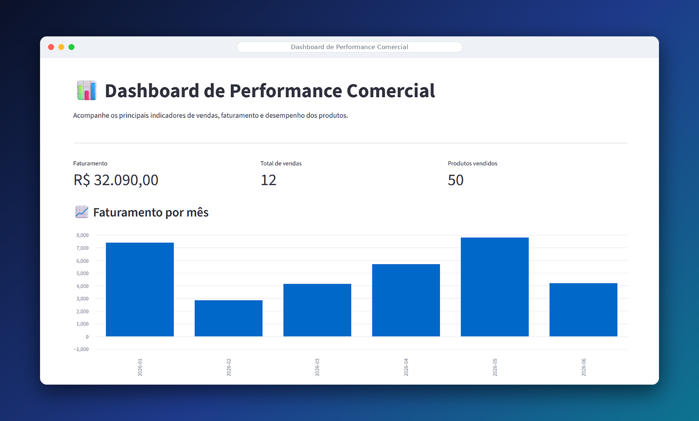

# Dashboard Inteligente de Vendas

Dashboard interativo desenvolvido em Python para acompanhar indicadores comerciais, analisar o desempenho de produtos e visualizar o faturamento de uma empresa fictícia.
## Prévia do projeto

## Objetivo

Praticar análise de dados, automação de indicadores e visualização de informações, transformando dados de vendas em informações úteis para apoiar decisões.

## Funcionalidades

- Filtros interativos por região e categoria.
- Indicadores de faturamento, vendas e unidades comercializadas.
- Gráfico de faturamento mensal.
- Gráfico de vendas por produto.
- Análise de faturamento por região.
- Analista de vendas com destaques e recomendações automáticas.
- Comparação de faturamento entre os últimos meses disponíveis.

## Tecnologias utilizadas

- Python
- Streamlit
- Pandas

## Sobre os dados

O projeto utiliza uma base de dados fictícia, criada exclusivamente para fins de estudo e demonstração.

## Analista de vendas

O analista utiliza regras e cálculos programados em Python para identificar destaques e gerar recomendações com base nos dados filtrados. Não utiliza, nesta versão, um modelo de inteligência artificial generativa.

## Como executar o projeto

1. Instale o Python.
2. Instale as dependências:

   `pip install streamlit pandas`

3. Execute o dashboard:

   `streamlit run app.py`

## Aprendizados

Este projeto foi desenvolvido para praticar programação em Python, manipulação de dados com Pandas, criação de dashboards interativos e análise de indicadores comerciais.